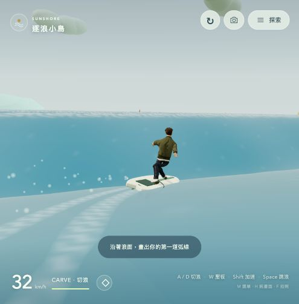

# 逐浪小島 · Sunshore

## [🏄 點此直接衝浪](https://rolanthhuang.github.io/surfingisland/)



以衝浪為核心的第三人稱小遊戲。從南灣浪線直接踩板出發，壓低重心追浪，以弧線切浪、爆發加速，再跳起落回浪面。沒有倒數。

## 衝浪操作

| 操作 | 效果 |
| --- | --- |
| A / D、左右方向鍵 | 左右切浪，保留向前滑行慣性 |
| W、上方向鍵 | 壓板、降低重心並加速 |
| S、下方向鍵 | 減速 |
| Shift | 消耗能量爆發加速；放開後隨滑行與切浪回復 |
| Space | 跳浪，落水時帶出水花 |
| 拖曳 / 滾輪 | 轉動 / 調整跟拍距離 |
| R | 回到南灣浪線 |
| M | 展開探索與設定 |
| H | 隱藏介面，再按一次恢復 |
| F | 定格拍照，可繼續拖曳調整鏡頭；再按一次繼續 |
| E / C | 選擇工具 / 近看人物 |

手機使用左搖桿控制壓板、減速與切浪，右側按鈕加速與跳浪。海浪聲在開始遊戲後啟動，可在探索選單關閉；聲音由本機合成，不需要錄音、麥克風或外部音源。

## v2.0：以衝浪為核心

- 預設海面踩板出發；左右輸入轉向板頭，放開仍會滑行。
- 有高度的移動湧浪，人物、板子、浪尾和水花共用同一個浪面；晴天與強風有不同浪高。
- 沿浪面角度與風、水流影響速度；壓板與爆發加速提供不同節奏。
- 側身屈膝站姿、前後腳位置、轉彎壓板與傾身，搭配低角度跟拍和隨速度改變的視角。
- 短板外形、尾墊、三鰭與腳繩，轉向帶出彎曲浪尾與噴濺。
- 主畫面只保留小型速度與能量提示，地圖、天氣與詳細資訊集中在探索選單。
- 純畫面與定格拍照模式；只保留精緻人物，已移除簡化人物及比較切換。

這是偏爽快的衝浪小遊戲，湧浪為程序式波形；尚未模擬破浪翻捲、管浪、流體動力或完整空中特技。

## 小島探索

在探索選單選擇沙灘、水面、障礙區或急流，可保留同一套工具遊玩。徒步與其他工具維持相對鏡頭的 WASD 移動方式。初始畫面的「漫遊小島」可從沙灘徒步出發。

範圍約 360 × 288 公尺，四周有浮標，外緣逐漸限制向外速度，仍可轉回。晴天微風 1.8 m/s，強風平均 12 m/s；可獨立改變八方向風向與反轉全島水流。潟湖、外海、北岸與東岸各有不同流速。

| 工具 | 沙灘一般 / 衝刺 | 水面一般 / 衝刺 | 特性 |
| --- | --- | --- | --- |
| 衝浪板 | 7.2 / 11.2 | 水面使用專用衝浪控制 | 沿浪、壓板、切浪、能量加速 |
| 水上摩托車 | 8 / 12 | 12 / 18 | 抗逆流、跨過 0.76 m 以下障礙 |
| 外骨骼助行器 | 9 / 14 | 7.6 / 11.6 | 跨過 1.05 m 以下障礙、跳得更高 |

表內為 m/s 基速，實際速度再受風、水流、加速、碰撞與邊界影響。小型衝浪速度提示使用 km/h，詳細資訊仍使用 m/s。可選擇地形變更時提示換裝；衝浪途中以文字提示取代強制暫停選單。

24 種環境組合與探索功能仍可在選單查看，紀錄只存在此分頁執行期間。

## 人物與授權

唯一人物使用完整皮膚、頭髮與服裝材質、54 根骨骼、行走與跑步動畫，衝浪姿勢另由骨架控制。這是精緻風格化模型，未達到主機 AAA 遊戲的寫實角色品質。

人物來源為 [Grab3D Casual Man（rigged）](https://grab3d.com/models/characters/man/)，CC0-1.0。原作者揭露模型、材質及自動綁骨動畫含 AI 輔助製作。授權與來源資料保留於 `assets/character/`。

Three.js r170、載入器與工具程式隨遊戲提供，授權見 [THREE-LICENSE.txt](vendor/THREE-LICENSE.txt)。程式、人物及所有素材由本站提供，執行期間不需要第三方請求。

## 在本機遊玩與驗證

不需要安裝套件或建置，以靜態 HTTP 伺服器提供此專案即可：

```sh
python3 -m http.server 8000
```

瀏覽器開啟 `http://localhost:8000`。`standalone.html` 含完整人物與遊戲，可單檔下載；使用 `python3 scripts/build-standalone.py` 重建。

需支援 WebGL 2。執行 `npm test` 驗證 23 項探索與工具規則、真實人物骨架長時間姿勢穩定、衝浪滑行、壓板與加速、弧線轉向、兩種天氣下的浪面浮力、跳浪及有限邊界。`npm run check` 檢查語法。畫面與互動另以瀏覽器實測。
