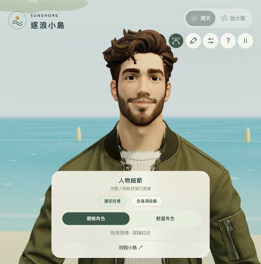

# 逐浪小島 · Sunshore

## [🏝️ 點此直接遊玩](https://rolanthhuang.github.io/surfingisland/)


有限地圖中的第三人稱沙灘與水面跑動遊戲。原創場景使用程式幾何，Three.js r170 固定版本隨站點提供，沒有執行階段外部依賴。

## 操作

- WASD / 方向鍵：相對鏡頭移動。
- Shift：衝刺；Space：跳躍。
- 拖曳畫面轉動鏡頭，滾輪拉近或拉遠。
- E：選擇工具；R：回南岸；Esc：暫停。
- C：人物細節；可切換臉部近看、全身與裝備，以及精緻／輕量角色。
- 手機：左搖桿移動，右鍵切換衝刺與跳躍。

主角在地形交界自動切換沙灘與水面跑動；低漂流木可跳越，高礁石需繞行。天氣、八方向風向和全島水流反轉可獨立操作。小地圖提供四個快速體驗點與俯瞰視角。

## 範圍與規則

可跑範圍約 160 × 128 公尺，外緣浮標定界；最後約 12 公尺僅對向外移動逐漸減速，向內與沿邊行走仍可操作。地形和碰撞共用 island.js 規則。

晴天微風 1.8 m/s，大風平均 12 m/s 並有陣風。基速：沙灘 6 / 衝刺 10 m/s；水面 5.4 / 衝刺 9 m/s。風速在前進方向上的分量乘 0.25，水流分量乘 0.9，並有少量側向漂流。HUD 的地形、風與流為目標速度分量；加速、跳躍、邊界及碰撞會使實際速度不同。角色不輸入移動時保持站定。

水流分為潟湖 1.6、外海 2.3、北岸 2.8、東側急流 3.8 m/s。水流不因改變天氣而改向。反轉按鈕同時反轉所有水域，風向獨立調整。

環境組合共 24 種：兩種天氣 × 三種風相對方向 ×（沙灘一類 + 水面三種流相對方向）。持續符合組合半秒且有效跑動即記錄；跳躍、碰撞與邊界不計入。紀錄僅保存在此分頁的執行期間。

以任意靜態 HTTP 伺服器提供此專案根目錄即可遊玩。需要支援 WebGL 2 的瀏覽器。圖像尺寸自適應，並會在持續低幀率時降低像素密度。


## 地形工具 · v1.1

切換到沙灘、水面或障礙區並穩定停留 0.7 秒後，會提示是否換用工具；兩次自動提示至少間隔 12 秒，避免岸邊來回觸發。選單會暫停遊戲，選擇後繼續。可取消「地形改變時提醒我」，仍可用 E 或 ◇ 隨時選擇。工具跨地形保留，自動套用對應增益，也可保持徒步。

| 工具 | 沙灘一般 / 衝刺 | 水面一般 / 衝刺 | 特性 |
| --- | --- | --- | --- |
| 衝浪板 | 7.2 / 11.2 | 8.2 / 13.2 | 順流加成較大，逆流阻力降低 |
| 水上摩托車 | 8 / 12 | 12 / 18 | 兩棲滑行，較抗風與逆流，自動跨 0.76 m 以下障礙 |
| 外骨骼助行器 | 9 / 14 | 7.6 / 11.6 | 自動跨 1.05 m 以下障礙，跳得更高 |

表內速度為 m/s 的基速，風、水流、加速與邊界會再影響實際速度。三種工具有實際場景造型；高礁石與棕櫚樹仍會阻擋，所有裝備皆受同一個有限地圖邊界限制。


## 在本機遊玩

不需要安裝套件或建置。於專案目錄開啟靜態伺服器：

```sh
python3 -m http.server 8000
```

瀏覽器開啟 `http://localhost:8000`。也提供整合所有程式的 `standalone.html`，可下載後以瀏覽器開啟。

## 人物更新 · v1.2

精緻角色採用完整服裝、頭髮與鬍鬚造型、皮膚與衣料貼圖、54 根骨骼，以及行走／跑步動畫。近看模式提供臉部、全身和舊版輕量人物比較。工具姿勢另以骨架調整；修正衝浪板和水上摩托車的蹲姿每格累積、導致人物下沉的問題。



這次是精緻風格化人物，尚未達到 PS5《蜘蛛人》或 GTA 的寫實人物品質；沒有面部表情系統、髮絲模擬或主機遊戲等級的動作捕捉。人物模型約 13 MB，首次載入會顯示進度，之後可切回輕量角色。

人物來源為 [Grab3D Casual Man（rigged）](https://grab3d.com/models/characters/man/)，採用 CC0-1.0。原作者揭露基礎模型、材質、綁骨和行走／跑步動畫含 AI 輔助製作。原始授權與來源資料保留在 `assets/character/`，模型與貼圖均由本站提供。

## 驗證

使用 Node.js 18 或以上執行 `npm test` 與 `npm run check`。23 項規則檢查涵蓋地形切換、工具速度與保留、順逆流、跳躍、自動跨障礙、硬障礙、邊界、24 種環境組合及提示防重複。另以實際人物骨架測試各工具連續 30 秒的姿勢穩定、工具切換、模型置中與跑步動畫。瀏覽器畫面另行目視檢查。

## 檔案

- `index.html` / `style.css`：遊戲介面與工具選擇。
- `game.js`：3D 場景、角色裝備、鏡頭與輸入控制。
- `character.js` / `assets/character/`：人物、材質、骨架動畫與工具姿勢。
- `island.js`：地形、水流、工具數值、移動、碰撞及提示規則。
- `tests/physics.mjs`：移動與工具驗證。
- `tests/character.mjs`：實際骨架與載具姿勢穩定測試。
- `standalone.html`：整合所有程式的單檔遊戲。
- `scripts/build-standalone.py`：重建含完整人物的單檔遊戲。
- `vendor/`：固定版本 Three.js r170，授權見 [THREE-LICENSE.txt](vendor/THREE-LICENSE.txt)。
